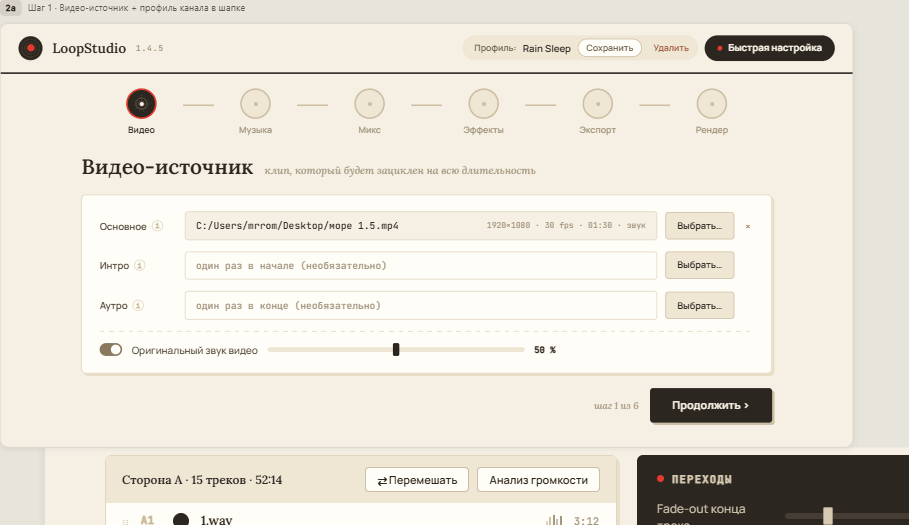
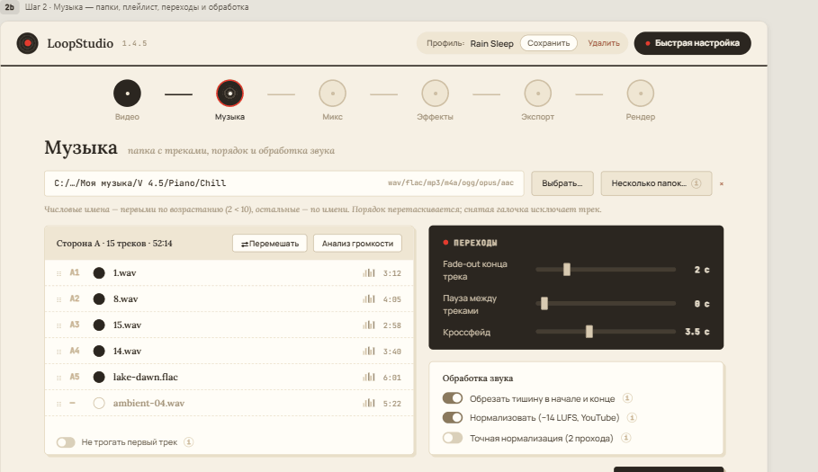
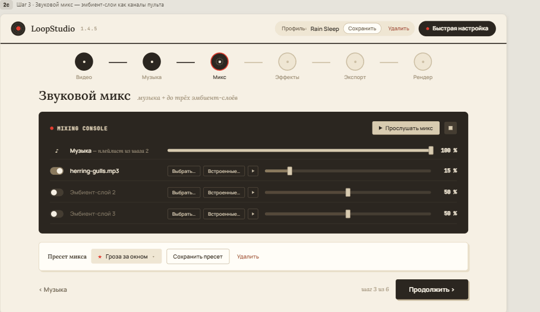
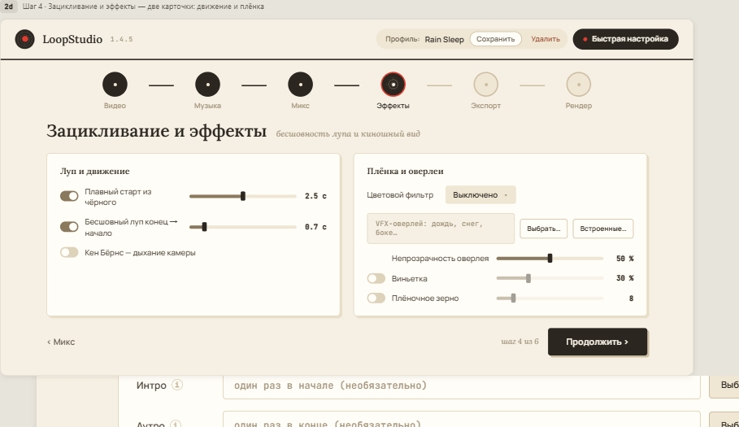
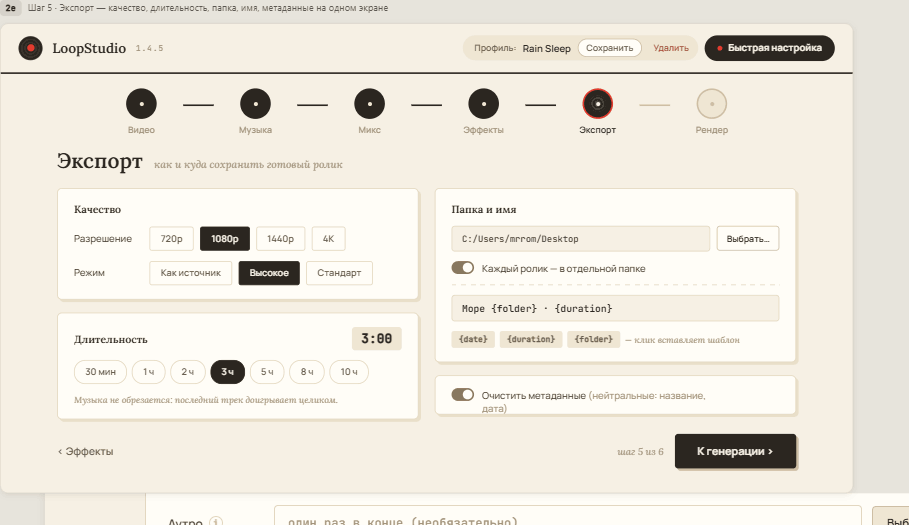
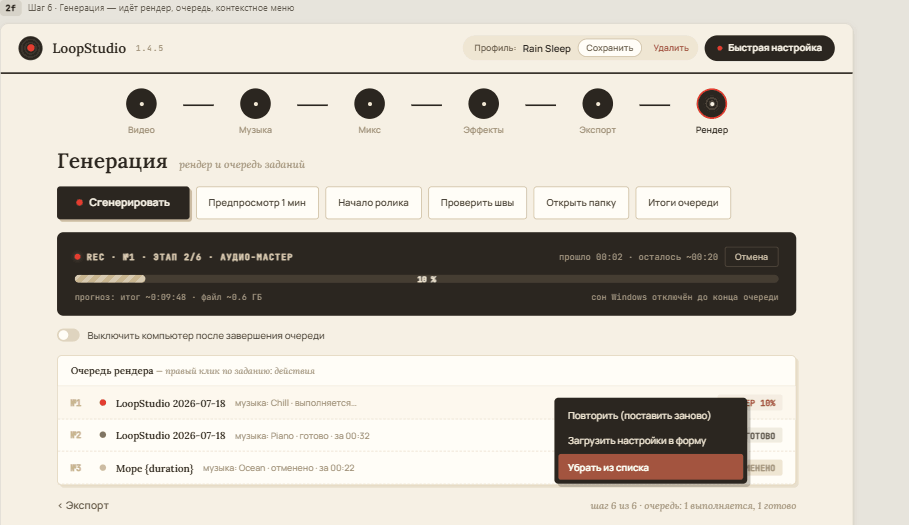
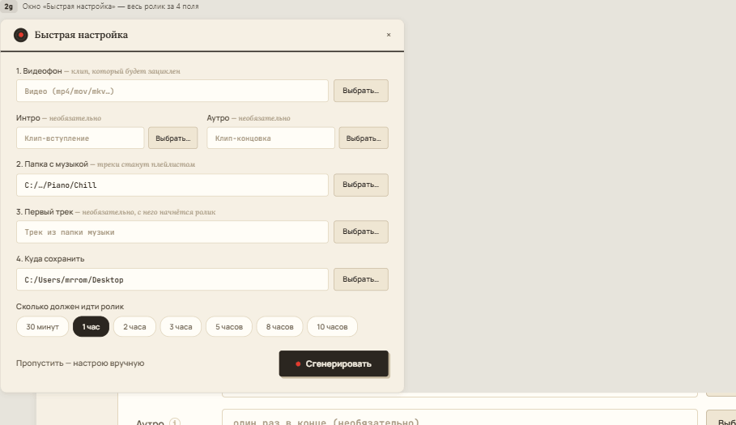

# LoopStudio — зацикленные видео для YouTube: атмосферные ролики, музыка и истории для сна, бесконечные трансляции 24/7

**LoopStudio — бесплатная программа для Windows, которая делает длинные зацикленные видео для ютуба: видеофон на повторе + плейлист музыки или историй + эмбиент-звуки (дождь, камин, ветер) + эффекты → готовый ролик от 1 минуты до 10 часов, вплоть до 4K.** Из такого файла получается атмосферное видео для сна, учёбы и работы, lo-fi радио, белый шум, сказки на ночь или бесконечная ютуб-трансляция 24/7.

Актуальная версия: **1.5.4** · Windows 10/11 (64-bit) · интерфейс на русском языке · [English summary below](#english-summary)

**[⬇ Скачать LoopStudio-1.5.4-setup.exe](https://github.com/MrRomecat/LoopStudio/releases/latest)** (≈ 223 МБ, FFmpeg уже внутри, Python устанавливать не нужно)

> **Ключ активации — бесплатно.** После установки программа при первом запуске попросит лицензионный ключ. Он выдаётся бесплатно по запросу: откройте [запрос ключа](https://github.com/MrRomecat/LoopStudio/issues/new?template=key-request.md) в разделе Issues. Подробнее — в разделе [Активация](#активация-и-ключ).

## Видеообзор

Полный разбор того, как работает программа, от выбора видеофона до готового ролика. Нажмите на обложку, видео откроется на YouTube:

[](https://www.youtube.com/watch?v=2MxnRaLnTCs)

▶ [Вы всё делаете вручную? Этот софт для зацикленных видео меняет всё!](https://www.youtube.com/watch?v=2MxnRaLnTCs)

---

## Содержание

- [Видеообзор](#видеообзор)
- [Для чего нужна LoopStudio](#для-чего-нужна-loopstudio)
- [Скриншоты](#скриншоты)
- [Возможности](#возможности)
- [Бесконечная трансляция на YouTube 24/7](#бесконечная-трансляция-на-youtube-247)
- [Как это работает внутри](#как-это-работает-внутри)
- [Системные требования](#системные-требования)
- [Установка](#установка)
- [Активация и ключ](#активация-и-ключ)
- [Первый ролик за пять минут](#первый-ролик-за-пять-минут)
- [Частые вопросы](#частые-вопросы)
- [Где хранятся данные](#где-хранятся-данные)
- [Известные ограничения](#известные-ограничения)
- [Лицензии и условия использования](#лицензии-и-условия-использования)
- [История версий](#история-версий)
- [English summary](#english-summary)

---

## Для чего нужна LoopStudio

LoopStudio создана для авторов YouTube-каналов, которые публикуют длинные видео на повторе. Такой ролик руками в видеоредакторе собирается часами, а здесь вы указываете видео, папку с музыкой и длительность, остальное программа делает сама, в фоне, с прогрессом и возможностью отмены.

Типичные форматы, под которые заточена программа:

- **Зацикленные видео для YouTube.** Короткий видеофон (камин, дождь за окном, ночной город, космос, аквариум) бесшовно повторяется 1, 3, 5 или 10 часов.
- **Атмосферные видео и эмбиент.** «Дождь и гроза для сна», «костёр ночью», «океанский прибой», «лесной ручей и сверчки»: видеофон + до трёх слоёв фоновых звуков из встроенной библиотеки (10 лупов) или ваших файлов.
- **Музыка для сна, учёбы и работы.** Плейлист из папки с треками: lo-fi, ambient, chillout, классика, медитация, white noise. Нормализация громкости под стандарт YouTube.
- **Истории для сна, сказки на ночь, аудиокниги, ASMR.** В папку кладёте начитанные главы вместо музыки: программа склеит их по порядку, добавит паузы между главами и тихий эмбиент, а видеоряд зациклит на всю длительность.
- **Бесконечные ютуб-трансляции 24/7.** Рендерите 10-часовой файл и крутите его в прямом эфире по кругу, см. [раздел про трансляции](#бесконечная-трансляция-на-youtube-247).
- **Серийное производство.** Профили каналов, пакетный режим по папкам, очередь рендера на ночь, треклист и главы для описания ролика.

Главное правило программы: **музыка никогда не обрезается.** Если вы задали 3 часа, а треки заканчиваются на 2:57, последний трек доиграет целиком. Ролик всегда получается чуть длиннее заданного, но ни один трек не оборвётся на середине.

## Скриншоты

Мастер из шести шагов в дизайне «Vinyl Warm»: Видео → Музыка → Микс → Эффекты → Экспорт → Рендер.

| Шаг 1 · Видео | Шаг 2 · Музыка |
|---|---|
|  |  |

| Шаг 3 · Микс | Шаг 4 · Эффекты |
|---|---|
|  |  |

| Шаг 5 · Экспорт | Шаг 6 · Рендер |
|---|---|
|  |  |

| Быстрая настройка |
|---|
|  |

## Возможности

### Шаг 1 · Видео

- Основное видео любой длины (от 5 секунд до нескольких часов) зацикливается на всю длительность ролика.
- Опциональные **интро** (один раз в начале) и **аутро** (один раз в конце).
- Оригинальный звук видео можно оставить и подмешать к музыке со своей громкостью.

### Шаг 2 · Музыка

- Указываете **папку** с треками: WAV, FLAC, MP3, M4A. Объём не ограничен.
- Умная сортировка: файлы с числовыми именами идут первыми по возрастанию (2 раньше 10), остальные по алфавиту. Порядок можно поменять перетаскиванием.
- Любой трек можно **исключить галочкой**, не удаляя файл из папки.
- **Перемешать** плейлист одной кнопкой, при этом «не трогать первый трек», если он задаёт настроение.
- Переходы: fade-out в конце трека (0–10 с), пауза между треками (0–5 с, в паузе звучит только эмбиент), кроссфейд (0–10 с).
- Обработка звука: обрезка тишины на хвостах, **нормализация к −14 LUFS** (стандарт YouTube), точная двухпроходная нормализация.
- **Анализ громкости**: показывает, какие треки заметно громче или тише остальных, до рендера.
- **Пакетный режим**: несколько папок за раз, по одному ролику на папку.

### Шаг 3 · Звуковой микс

- Общая громкость музыки.
- До **трёх эмбиент-слоёв** (дождь, камин, ветер, кафе…) с отдельной громкостью. Эмбиент зацикливается бесшовно и плавно затухает в самом конце ролика.
- **Встроенная библиотека** из 10 эмбиентов, созданных процедурно: дождь, ливень с грозой, костёр, метель, океан, лесной ручей, ночные сверчки, коричневый шум, розовый шум, шум винила. Без чужих записей, без риска Content ID. Можно подключать и свои файлы.
- **Прослушать микс**: 30-секундная проба музыки с эмбиентом без полного рендера.
- **Пресеты микса**: сохраняйте удачный баланс под каждый канал. Есть заводские пресеты.

### Шаг 4 · Эффекты

- **Плавный старт** из чёрного с fade-in звука.
- **Бесшовный луп**: переход «конец → начало» с настраиваемой длительностью, чтобы шов цикла не бросался в глаза.
- **Кен Бёрнс**: медленное «дыхание камеры» поверх статичного видео.
- Цветовые фильтры: тёплый, холодный, ночной, VHS, сепия.
- **VFX-оверлеи**: 5 встроенных (дождь на объективе, снегопад, боке, пылинки в луче, светлячки), можно загрузить свой, с регулировкой непрозрачности.
- Виньетка и плёночное зерно.

### Шаг 5 · Экспорт

- Разрешение **720p / 1080p / 1440p / 4K**.
- Режимы качества: «Как источник», «Высокое», «Стандарт».
- Аппаратное кодирование определяется автоматически: **NVIDIA NVENC, Intel QSV, AMD AMF**, иначе программный x264.
- Длительность: быстрые кнопки 30 мин / 1 / 2 / 3 / 5 / 8 / 10 ч или точное значение ЧЧ:ММ.
- Папка сохранения запоминается. Шаблон имени файла с токенами `{date}`, `{duration}`, `{folder}`.
- «Каждый ролик в отдельной папке»: рядом с mp4 ложатся треклист, паспорт рендера и файл проекта.
- **Очистка метаданных**: из исходников ничего не переносится, вместо этого ставятся нейтральные значения (название, дата).

### Шаг 6 · Рендер и очередь

- **Очередь рендера**: ставьте несколько роликов подряд, они выполняются последовательно. Упавшее задание не останавливает остальные.
- Прогресс с этапом и оценкой оставшегося времени, кнопка **Отмена**.
- **Предпросмотр 1 минута**: быстрая проба в низком качестве тем же конвейером.
- **«Начало ролика»** и **«Проверить швы»**: короткие проверки старта и стыков лупа без полного рендера.
- Windows **не уснёт** во время рендера. Опция «выключить компьютер после завершения очереди» с возможностью отмены.
- **Журнал очереди на диске**: после перезагрузки программа предложит восстановить незавершённые задания.
- Уведомления Windows по завершении задания и очереди, экран «Итоги очереди».
- Контекстное меню задания: открыть ролик, показать в папке, открыть паспорт рендера, повторить, загрузить настройки в форму, отменить, убрать из списка.
- **Автопроверка готового файла**: длительность и целостность сверяются после рендера.

### Что получается на выходе

- Файл **MP4 (H.264 + AAC)** нужной длины.
- **Треклист** `ЧЧ:ММ:СС Название` для описания ролика на YouTube.
- **Главы** внутри mp4.
- **Паспорт рендера**: фактическая длительность, список треков и кругов, таймкоды стыков, кодер, предупреждения.
- Файл проекта `.lsproj`, по которому ролик можно пересобрать в любой момент.

### Удобство работы

- **Быстрая настройка**: один диалог с минимумом вопросов, из которого сразу запускается рендер.
- **Профили каналов**: все настройки формы под каждый канал в один клик.
- Проекты `.lsproj`: открыть, сохранить, недавние проекты, тихое сохранение по Ctrl+S, автосохранение формы.
- При открытии проекта проверяются пути и плейлист, перемещённую папку можно перепривязать одним действием.
- Подсказка ⓘ у каждой функции.
- Интерфейс масштабируется вместе с окном (минимум 1180×760).

## Бесконечная трансляция на YouTube 24/7

LoopStudio не выходит в эфир сама: она делает **видеофайл**, который вы запускаете по кругу. Так устроены все круглосуточные ютуб-трансляции с музыкой: «lo-fi hip hop radio», «дождь для сна 24/7», «камин live» и подобные.

1. В LoopStudio соберите ролик на **8–10 часов** с включённым бесшовным лупом (шаг 4) и плавным стартом. Чем длиннее файл, тем реже зритель увидит повтор плейлиста.
2. Откройте **OBS Studio** (бесплатная), добавьте источник «Медиаисточник», укажите готовый mp4 и поставьте галочку **«Повторять»** (Loop). Файл будет крутиться бесконечно.
3. В YouTube Studio создайте трансляцию, скопируйте ключ потока в OBS и нажмите «Запустить трансляцию».

Советы:

- Для стабильного эфира включите в YouTube задержку «Обычная», а в OBS выставьте битрейт 4500–9000 кбит/с для 1080p.
- Файл для эфира рендерите в режиме «Высокое» или «Как источник»: YouTube пережмёт поток ещё раз, запас качества не помешает.
- Тот же файл можно опубликовать как обычное видео или премьеру: треклист из LoopStudio вставьте в описание, главы YouTube подхватит автоматически.

## Как это работает внутри

- **Резиновый таймлайн.** Треки добавляются по кругу, пока их сумма не покроет заданную длительность. Итог всегда не меньше заданного, последний трек целый.
- **Аудио-мастер одним проходом.** Треки, паузы, фейды, кроссфейды, эмбиент и нормализация сводятся в один мастер-файл.
- **Сегментный рендер видео.** С эффектами кодируется только один луп-сегмент, затем он размножается до нужной длины без перекодирования. Поэтому трёхчасовой ролик в 4K собирается за десятки минут, а не часов, и середина ролика побайтово повторяет сегмент: если первая минута чистая, то и пятый час чистый.
- Всё тяжёлое выполняется в фоне встроенным FFmpeg. Интерфейс не блокируется, любая операция отменяется.
- Временные файлы создаются в системной папке temp и всегда удаляются, даже при ошибке.

## Системные требования

| | |
|---|---|
| ОС | Windows 10 или Windows 11, 64-bit |
| Место на диске | ≈ 550 МБ для программы + место под временные файлы рендера (ориентир: до 3× размера итогового ролика) |
| Видеокарта | не обязательна. С NVIDIA (NVENC), Intel (QSV) или AMD (AMF) рендер заметно быстрее |
| Интернет | не нужен ни для работы, ни для активации |
| Python, FFmpeg | устанавливать не нужно, всё внутри установщика |

## Установка

1. Скачайте `LoopStudio-1.5.4-setup.exe` со страницы [Releases](https://github.com/MrRomecat/LoopStudio/releases/latest).
2. Запустите установщик.
   Установщик **не подписан сертификатом**, поэтому Windows SmartScreen может показать окно «Система Windows защитила ваш компьютер». Нажмите **«Подробнее»**, затем **«Выполнить в любом случае»**. Подлинность файла можно проверить по контрольной сумме ниже.
3. Выберите язык установщика (русский или английский) и режим: для всех пользователей (нужны права администратора) или только для текущего пользователя.
4. При желании поставьте галочку «Создать значок на рабочем столе». Нажмите «Установить».
5. После установки программа запустится сама и попросит ключ активации, см. [следующий раздел](#активация-и-ключ).

**Контрольная сумма SHA-256** файла `LoopStudio-1.5.4-setup.exe`:

```
055fc5ccb586e38d368270213aa4e2206f28b1e8bb99922a2ac92c086c4bf6a7
```

Проверить в PowerShell:

```powershell
Get-FileHash .\LoopStudio-1.5.4-setup.exe -Algorithm SHA256
```

**Обновление.** Новую версию ставьте поверх старой: установщик сам удалит устаревшие файлы программы. Настройки, профили, проекты и активация сохраняются.

**Удаление.** Параметры Windows → Приложения → LoopStudio → Удалить. Папка с настройками `%APPDATA%\LoopStudio` при этом не трогается, её можно удалить вручную.

**Тихая установка** (для админов):

```powershell
.\LoopStudio-1.5.4-setup.exe /VERYSILENT /NORESTART
```

## Активация и ключ

При первом запуске откроется окно «Активация LoopStudio» с полем для ключа. Без ключа основной экран программы не открывается.

**Ключ выдаётся бесплатно по запросу.**

1. Откройте [запрос ключа](https://github.com/MrRomecat/LoopStudio/issues/new?template=key-request.md) в разделе Issues этого репозитория (нужен аккаунт GitHub).
2. В ответ вы получите ключ вида `LSTD-XXXX-XXXX-XXXX-…`.
3. Вставьте ключ целиком в окно активации и нажмите **«Активировать»**.

Как устроена активация:

- Проверка ключа происходит **оффлайн**, интернет не нужен. Программа не отправляет никаких данных.
- Ключ **привязывается к компьютеру**, на котором активирован. Переустановка Windows или перенос на другой ПК потребуют нового ключа: просто запросите его ещё раз.
- Активация хранится в `%APPDATA%\LoopStudio\license.dat` и переживает обновления программы.
- Если программа пишет «Ключ повреждён», проверьте, что ключ скопирован целиком, без лишних пробелов и переносов строк.

## Первый ролик за пять минут

1. Нажмите **«Быстрая настройка»** в шапке окна.
2. Укажите видео-фон, папку с музыкой и длительность.
3. Нажмите **«Сгенерировать»**. Диалог закроется, прогресс появится внизу формы.
4. По завершении нажмите **«Открыть папку»**: рядом с mp4 лежат треклист и паспорт рендера.

Если хотите пройти все шесть шагов руками, двигайтесь по степперу сверху: Видео → Музыка → Микс → Эффекты → Экспорт → Рендер. Переход между шагами свободный. Весь процесс целиком показан в [видеообзоре](https://www.youtube.com/watch?v=2MxnRaLnTCs).

## Частые вопросы

**Как сделать зацикленное видео для YouTube на 10 часов?**
Выберите короткий видеофон на шаге 1, папку с музыкой на шаге 2, на шаге 4 включите бесшовный луп, на шаге 5 поставьте длительность 10 ч и нажмите «Сгенерировать». Кодируется только один сегмент, остальное копируется, поэтому даже 10 часов в 4K собираются за десятки минут.

**Как сделать видео для сна с дождём или камином?**
На шаге 3 включите эмбиент-слои: встроенные дождь, ливень с грозой, костёр, метель, океанский прибой, лесной ручей, ночные сверчки, коричневый и розовый шум, тёплый шум винила, либо свои записи (камин, кафе, белый шум). Громкость каждого слоя регулируется отдельно, прослушать микс можно до рендера.

**Подходит ли программа для историй на ночь и аудиокниг?**
Да. Вместо музыки положите в папку главы в MP3, M4A, WAV или FLAC. Они пойдут по порядку номеров в именах файлов, между главами можно поставить паузу, а тихий эмбиент заполнит тишину.

**Можно ли сделать бесконечную ютуб-трансляцию?**
Да, через OBS: рендерите длинный файл и запускаете его на повторе, см. [раздел выше](#бесконечная-трансляция-на-youtube-247).

**Нужны ли свои звуки и видео?**
Для старта нет: в комплекте 10 эмбиентов, 5 VFX-оверлеев, демо-фоны и демо-треки, все созданы процедурно и свободны от претензий Content ID. Для настоящих роликов используйте свою музыку или библиотеки с лицензией.

**Нужен ли мощный компьютер?**
Нет. На любом ПК с Windows 10/11 ролик соберётся программным кодеком. С видеокартой NVIDIA, Intel или AMD рендер заметно быстрее.

**Сколько стоит?**
Нисколько. Программа бесплатна, ключ активации выдаётся бесплатно по [запросу](https://github.com/MrRomecat/LoopStudio/issues/new?template=key-request.md).

## Где хранятся данные

| Что | Где |
|---|---|
| Настройки, профили каналов, пресеты микса | `%APPDATA%\LoopStudio\settings.json` |
| Активация | `%APPDATA%\LoopStudio\license.dat` |
| Журнал очереди рендера | `%APPDATA%\LoopStudio\queue_journal.json` |
| Журнал приложения | `%APPDATA%\LoopStudio\logs\loopstudio.log`, открывается из меню **Проект → Открыть журнал приложения** |
| Проекты `.lsproj` | где сохраните; копия кладётся рядом с каждым готовым роликом |
| Временные файлы рендера | системная папка temp, удаляются автоматически |

## Известные ограничения

- Только Windows. Версий для macOS и Linux нет.
- Интерфейс только на русском языке.
- Установщик не подписан сертификатом: SmartScreen предупреждает при первом запуске.
- Один ключ активирует один компьютер.
- Выходной формат один: MP4 (H.264 + AAC). Для YouTube этого достаточно.
- Порядок заданий в очереди менять нельзя: только добавлять, повторять и убирать.

## Лицензии и условия использования

**LoopStudio** распространяется бесплатно в виде готовой сборки. Ролики, созданные в программе, принадлежат вам целиком, включая монетизированные каналы. Перепродавать программу и выдавать её за свою нельзя.

**Встроенная библиотека** (10 эмбиентов, 5 оверлеев, демо-фоны и демо-треки) создана процедурно и свободна от прав третьих лиц: используйте в любых роликах без указания авторства, см. [licenses/ASSETS-LICENSE.txt](licenses/ASSETS-LICENSE.txt).

**Сторонние компоненты** в составе сборки, полный перечень в [licenses/NOTICE.txt](licenses/NOTICE.txt):

| Компонент | Лицензия |
|---|---|
| FFmpeg (сборка gyan.dev full) | GPL-3.0, текст в [licenses/GPL-3.0.txt](licenses/GPL-3.0.txt). Исходный код этой сборки доступен на https://www.gyan.dev/ffmpeg/builds/ и предоставляется по запросу |
| Qt 6 / PySide6 | LGPL-3.0, текст в [licenses/LGPL-3.0.txt](licenses/LGPL-3.0.txt) |
| Python 3.13 | PSF License |
| cryptography | Apache-2.0 / BSD-3-Clause |
| Шрифты Lora, Manrope, JetBrains Mono | SIL Open Font License 1.1 |

Эти лицензии касаются только распространения самой программы и никак не ограничивают ваши ролики.

## История версий

Полный список в [CHANGELOG.md](CHANGELOG.md).

- **1.5.4** — текущая версия: дизайн «Vinyl Warm», мастер из 6 шагов, фирменные шрифты и иконка, масштабирование интерфейса.
- **1.4.5** — «Быстрая настройка» запускает рендер напрямую; предпродажный аудит с 40+ исправлениями.
- **1.4.0** — мастер первого запуска, встроенная библиотека звуков и оверлеев, заводские пресеты.
- **1.3.0** — плавный старт, обрезка тишины, точная нормализация, анализ громкости, «Начало ролика», «Проверить швы», исключение треков, перемешивание.
- **1.2.0** — профили каналов, пакетный режим, автосохранение, недавние проекты, пакет-папка на ролик.
- **1.1.0** — keep-awake и выключение ПК, журнал очереди с восстановлением, уведомления, паспорт рендера, пре-флайт.
- **1.0.0** — первая рабочая версия, подтверждена рендерами 2.5–5 часов в 4K.

## Обратная связь

Ошибки, вопросы и пожелания: [Issues](https://github.com/MrRomecat/LoopStudio/issues). При сообщении об ошибке приложите журнал приложения (меню **Проект → Открыть журнал приложения**) и паспорт рендера, если он успел создаться.

## English summary

**LoopStudio** is a free Windows app that builds long **looping videos for YouTube**: a seamlessly looped video background + a music or narration playlist + up to three ambient sound layers (rain, fireplace, wind, café) + effects, rendered as a single MP4 from 1 minute to **10 hours**, up to **4K**.

Typical use: **ambient videos**, **sleep music**, **sleep stories and bedtime audiobooks**, lo-fi radio, brown/pink noise, study/work playlists, and **24/7 YouTube live streams** (render a 10-hour file and loop it in OBS).

Highlights: music is never cut mid-track, −14 LUFS normalization, crossfades and pauses, built-in royalty-free ambience library, Ken Burns motion, color filters and VFX overlays, NVENC/QSV/AMF hardware encoding, render queue with crash recovery, tracklist and chapters for the YouTube description, project files and channel profiles.

Watch the full walkthrough (in Russian): [video overview on YouTube](https://www.youtube.com/watch?v=2MxnRaLnTCs). Download the installer from [Releases](https://github.com/MrRomecat/LoopStudio/releases/latest). The app asks for an activation key on first launch; **keys are free on request**, just open a [key request issue](https://github.com/MrRomecat/LoopStudio/issues/new?template=key-request.md). The interface is in Russian.
